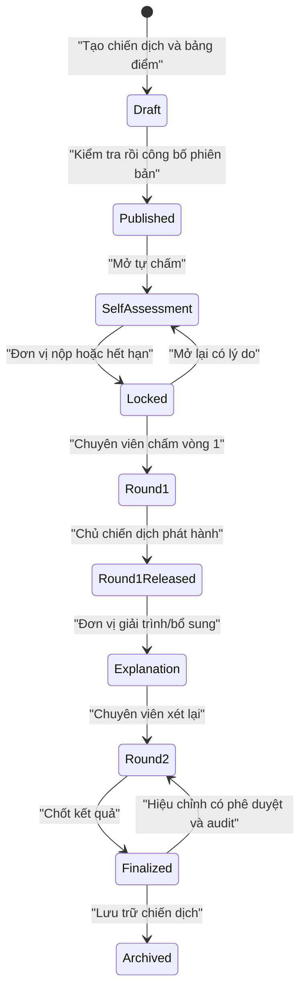
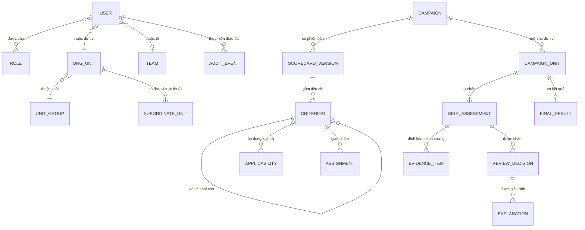
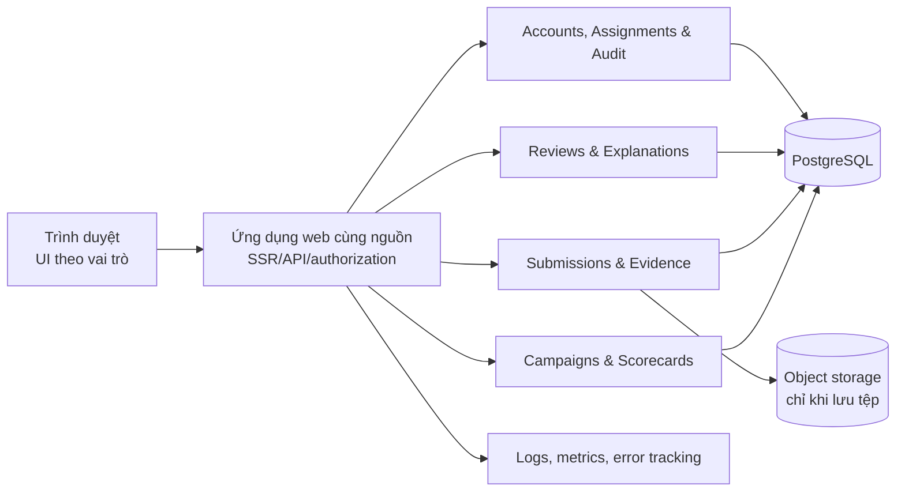

# Phân tích tiền dự án — Hệ thống quản lý chấm điểm đơn vị Đoàn

> Phiên bản phân tích: 11/08/2026  
> Trạng thái: **Bản phân tích trước xây dựng — chưa phải đặc tả đã được khách hàng phê duyệt**  
> Nguyên tắc: đơn giản có chủ đích, rõ trách nhiệm, không hy sinh bảo mật, khả năng tiếp cận hay tính toàn vẹn dữ liệu.

## 0. Kết luận điều hành

Dự án nên được hiểu là **hệ thống điều phối một quy trình đánh giá có bằng chứng và có tranh luận**. Excel là hệ thống nghiệp vụ hiện tại và là hợp đồng tương thích bắt buộc, nhưng sản phẩm không chỉ dừng ở việc tải file lên rồi sửa ô. Giá trị cốt lõi của sản phẩm là:

1. mỗi người chỉ thấy và làm đúng phần việc của mình;
2. tiêu chí, thời hạn và cách tính điểm không bị hiểu khác nhau giữa các bên;
3. mọi lần tự chấm, chấm vòng 1, giải trình, chấm vòng 2 và mở lại đều có lịch sử;
4. kết quả cuối có thể giải thích, đối soát và xuất lại;
5. trải nghiệm đủ đơn giản để 134 đơn vị sử dụng mà không cần “học một phần mềm mới”.

Kiến trúc phù hợp nhất ở quy mô hiện tại là **modular monolith**: một ứng dụng web, một cơ sở dữ liệu PostgreSQL, lưu trữ tệp riêng khi cần, triển khai như một hệ thống duy nhất. Các module được tách theo nghiệp vụ nhưng chưa tách thành microservice. Đây là lựa chọn có chủ đích vì dữ liệu hiện tại chỉ có khoảng 164 tài khoản và vài nghìn dòng chấm điểm mỗi chiến dịch.

Ba điều chưa được phép “đoán” trước khi xây dựng dữ liệu thật:

- chính xác có 4 hay 5 loại bảng điểm;
- mô hình quyền của 5 Admin, 5 SubAdmin1 và 20 SubAdmin2;
- công thức điểm thưởng, giới hạn 25 điểm và mẫu II.1 đang mâu thuẫn nhau.

## 1. Cơ sở phân tích và độ tin cậy

### 1.1. Nguồn đầu vào

| Nguồn | Nội dung dùng để phân tích | Mức tin cậy / lưu ý |
|---|---|---|
| [duananhCuong.pdf](<E:/Sach/Sua/duan_quan_ly_doan/duananhCuong.pdf>) | Vai trò, số lượng đơn vị, bảng điểm động, quy trình 5 bước, công thức và lộ trình mong muốn | Nguồn yêu cầu chính nhưng còn mâu thuẫn nội bộ |
| [Bảng điểm Chiến dịch TNTN Hè 2026.xlsx](<E:/Sach/Sua/duan_quan_ly_doan/2. (ĐHCĐ) Bảng điểm Chiến dịch TNTN Hè 2026.xlsx>) | Cấu trúc tiêu chí, điểm cơ bản/điểm thưởng, công thức xếp loại, bằng chứng và lý do trừ điểm | Là hệ thống AS-IS thực tế. Shared formula tổng hợp hoạt động; còn mâu thuẫn vai trò vùng nhập, cap điểm thưởng và kiểm soát dữ liệu |
| [Danh sách tài khoản liên quan](https://docs.google.com/spreadsheets/d/1z_6qt6sKce7x_AYhM2ODzEJnNIabvSMgsINPzxZ6JhM/edit?gid=0#gid=0) | Cơ cấu tài khoản, tổ chuyên môn, khối đơn vị | Có dữ liệu cá nhân; báo cáo này chỉ dùng số lượng tổng hợp |
| [Ảnh giao diện tham khảo](<E:/Sach/Sua/duan_quan_ly_doan/anhthamkhao.jpg>) | Mô hình điều hướng, bảng tiến độ, nộp minh chứng, giải trình, kết quả, lịch sử | Chỉ tham khảo mô hình tinh thần, không sao chép giao diện |
| [Neko Core — web-app skill tại commit 0869512](https://github.com/meiiie/neko-core/blob/0869512c7ba8c300d6be7747adac1eda342c6a91/skills/web-app/SKILL.md) | Quy trình spec → architecture → vertical slice → hardening → verification | Dùng như khung phương pháp, không coi là tiêu chuẩn bắt buộc |
| [Neko Core — hackathon engine](https://github.com/meiiie/neko-core/blob/0869512c7ba8c300d6be7747adac1eda342c6a91/skills/hackathon-engine/SKILL.md) | Tư duy constraint-first, demo có kiểm chứng, cắt phạm vi | Chỉ lấy phần hữu ích; không áp dụng shortcut hackathon cho production |

### 1.2. Phân biệt dữ kiện, suy luận và quyết định

- **Dữ kiện**: xuất hiện trực tiếp trong PDF, workbook hoặc danh sách tài khoản.
- **Suy luận đề xuất**: cách hiểu hợp lý để thiết kế; phải được xác nhận trong buổi chốt nghiệp vụ.
- **Quyết định kiến trúc tạm thời**: baseline để ước lượng và tạo prototype; có thể đổi nếu hạ tầng, ngân sách hoặc chính sách tổ chức yêu cầu.

Không có giả định nào trong tài liệu này được coi là yêu cầu khách hàng đã duyệt.

## 2. Hiện trạng và vấn đề cần giải quyết

Quy trình hiện tại dựa trên Excel gửi qua lại. Điều này tạo bốn nhóm rủi ro:

- **Nhiều phiên bản sự thật**: khó biết file nào là mới nhất, công thức nào đã bị sửa và ai sửa.
- **Quyền truy cập thô**: Excel không mô hình hóa tốt việc một chuyên viên chỉ chấm những tiêu chí được phân công trên 134 đơn vị.
- **Giải trình rời rạc**: lý do trừ điểm, bằng chứng bổ sung và điểm vòng sau dễ tách khỏi ngữ cảnh ban đầu.
- **Thiếu dấu vết kiểm toán**: khó tái dựng một kết quả từ tiêu chí, bằng chứng và các quyết định trước đó.

### 2.1. Quy mô người dùng đã đối chiếu

| Nhóm tài khoản | Số lượng trong danh sách | Diễn giải sơ bộ |
|---|---:|---|
| Admin | 5 | Chưa rõ tất cả có toàn quyền chỉnh sửa hay có người chỉ quan sát/phê duyệt |
| SubAdmin1 | 5 | Có vẻ là đầu mối/lead của 5 tổ |
| SubAdmin2 | 20 | Có vẻ là chuyên viên chấm theo tiêu chí |
| User | 134 | Các đơn vị tự chấm; không tự đăng ký |
| **Tổng** | **164** | Quy mô nhỏ, tải giao dịch thấp |

Năm tổ xuất hiện trong danh sách: **Trường học (TH), Tổ chức–Kiểm tra (TCKT), Tuyên giáo (TG), Phong trào (PT), Văn phòng (VP)**. Tên gọi này cần chuẩn hóa với cách gọi trong PDF.

### 2.2. Cơ cấu 134 đơn vị

| Khối | Số đơn vị |
|---|---:|
| Xã, phường, đặc khu | 114 |
| Đại học, cao đẳng | 16 |
| Khối công chức | 2 |
| Khối lực lượng vũ trang | 2 |
| **Tổng** | **134** |

## 3. Các mâu thuẫn và khoảng trống phải chốt

| Mã | Quan sát | Rủi ro nếu không chốt | Mức độ |
|---|---|---|---|
| Q-01 | PDF liệt kê 4 khối nhưng nói có 5 loại bảng điểm | Sai mô hình áp dụng tiêu chí và denominator | Chặn thiết kế dữ liệu |
| Q-02 | PDF nói khoảng 20 SubAdmin; danh sách có 5 SubAdmin1 + 20 SubAdmin2 | Cấp sai quyền xem/chấm/phê duyệt | Chặn ma trận quyền |
| Q-03 | Có 5 tài khoản Admin trong khi mô tả vai trò dùng số ít “Bí thư” | Không rõ ai được công bố, mở khóa, sửa cấu hình | Chặn quy tắc phê duyệt |
| Q-04 | Tên workbook chính ghi năm 2025 nhưng chiến dịch và tiêu chí là 2026 | Sai nhãn báo cáo chính thức | Cần sửa dữ liệu nguồn |
| Q-05 | Sheet chính tô vàng `H5:H34` (Được chấm) và `K5:K34` (Link), trong khi sheet thưởng tô vàng các trường của đơn vị; workbook không có protection hay data validation | Đơn vị và người chấm có thể sửa nhầm hoặc sửa sai phạm vi | Chặn thiết kế quyền nhập |
| Q-06 | Điểm thưởng II.1 ghi tối đa 3 hoạt động × 3 điểm = 9, nhưng mẫu có 10 dòng và tổng tối đa 30; toàn phần thưởng lại bị chặn ở 25 | Công thức tổng/xếp loại có thể sai | Chặn engine tính điểm |
| Q-07 | Chưa rõ bỏ một tiêu chí cho riêng đơn vị có làm giảm điểm chuẩn ở mẫu số hay không | Tỉ lệ hoàn thành không công bằng | Chặn công thức |
| Q-08 | Xếp loại Excel dùng “Có khả năng đạt XS” thay vì kết quả “Xuất sắc” | Không rõ đây là dự báo hay kết luận chính thức | Cao |
| Q-09 | Chưa rõ chuyên viên có thể chấm cao hơn tự chấm không, bước điểm cho phép là 0,5 hay tùy tiêu chí | Sai validation | Cao |
| Q-10 | Minh chứng bằng URL có thể bị thay đổi hoặc mất quyền truy cập sau khi chấm | Không tái kiểm chứng được kết quả | Cao |
| Q-11 | Chưa rõ hạn chung, hạn riêng, gia hạn và múi giờ khóa | Khóa nhầm bài nộp | Cao |
| Q-12 | Chưa rõ một tiêu chí có một hay nhiều người chấm; vai trò người thay thế và người duyệt | Trùng/chồng quyết định | Cao |
| Q-13 | Chưa rõ SubAdmin được xem toàn bộ dữ liệu hay chỉ phần được phân công | Vi phạm nguyên tắc tối thiểu quyền | Cao |
| Q-14 | Chưa có chính sách lưu giữ, xóa, xuất hồ sơ và sửa kết quả đã chốt | Rủi ro pháp lý/vận hành | Cao |

## 4. Mô hình nghiệp vụ chuẩn hóa đề xuất

### 4.1. Các vai trò nghiệp vụ

Tên kỹ thuật không nên đóng cứng theo “Admin1/Admin2”. Hệ thống nên biểu diễn **năng lực** và **phạm vi**:

| Vai trò nghiệp vụ | Năng lực chính | Phạm vi |
|---|---|---|
| Quản trị hệ thống | Quản lý hạ tầng tài khoản, khôi phục truy cập; không mặc nhiên sửa điểm | Toàn hệ thống nhưng tách khỏi quyền nghiệp vụ nếu có thể |
| Chủ chiến dịch | Tạo bảng điểm, công bố, đặt hạn, mở lại, phát hành kết quả | Theo chiến dịch |
| Trưởng tổ | Phân công/giám sát tiêu chí, duyệt ngoại lệ nếu được ủy quyền | Theo tổ và chiến dịch |
| Chuyên viên chấm | Chấm tiêu chí được giao, phản hồi giải trình | Theo tiêu chí × nhóm/đơn vị × vòng |
| Đơn vị | Tự chấm, nộp minh chứng, giải trình, xem kết quả được công bố | Chỉ đơn vị của mình |
| Quan sát/kiểm tra | Xem báo cáo và audit, không sửa dữ liệu | Theo phạm vi được cấp |

Sau khi khách hàng chốt, 5 Admin/SubAdmin1/SubAdmin2 hiện có sẽ được ánh xạ vào các vai trò này. Cách này giữ mô hình rõ hơn và tránh “role explosion”.

### 4.2. Tiếp nhận và phân bổ hạng mục

Trước khi mở một chiến dịch cho đơn vị tự chấm, có một luồng cấu hình độc lập:

1. Trung ương giao danh mục hạng mục; Hải Phòng tiếp nhận và giữ bất biến nguồn.
2. Hải Phòng xác định từng hạng mục áp dụng cho khối nào bằng ma trận `hạng mục × khối`.
3. Hải Phòng giao tổ chuyên môn hướng dẫn và thẩm định; quyết định này độc lập với phạm vi khối.
4. Người có thẩm quyền rà soát quy tắc rồi ban hành snapshot phân bổ bất biến.
5. Đơn vị chỉ nhận hạng mục được áp dụng cho khối của mình trong snapshot đang có hiệu lực.

Hiện có bằng chứng cho 4 khối với 134 đơn vị: 114 xã/phường/đặc khu, 16 ĐH/CĐ, 2 khối công chức và 2 khối lực lượng vũ trang. Tài liệu nói 5 loại bảng nhưng chỉ liệt kê 4 khối; không được tự tạo khối thứ năm khi chưa có tên và danh sách đơn vị.

### 4.3. Vòng đời một chiến dịch

Các chuyển trạng thái phải được kiểm tra ở **máy chủ**, không chỉ ẩn nút trên giao diện. Mở lại hoặc hiệu chỉnh phải lưu người thực hiện, thời điểm, lý do, trạng thái trước/sau.

### 4.4. Vòng đời một hồ sơ đơn vị

1. Hệ thống tạo một bản áp dụng bảng điểm đã **đóng băng theo phiên bản** cho đơn vị.
2. Đơn vị tự chấm, nhập báo cáo ngắn và thêm minh chứng. Tiêu chí dạng “100% đơn vị trực thuộc” có các dòng con có cấu trúc.
3. Đơn vị nộp hoặc hệ thống tự khóa khi hết hạn; dữ liệu trở thành chỉ đọc.
4. Chuyên viên chấm vòng 1. Nếu điểm thấp hơn tự chấm, lý do trừ là bắt buộc.
5. Điểm vòng 1 ẩn với đơn vị cho đến khi người có thẩm quyền phát hành đồng loạt hoặc theo quy tắc đã chốt.
6. Đơn vị giải trình trên từng chênh lệch và có thể bổ sung minh chứng.
7. Chuyên viên đưa ra điểm vòng 2; người có thẩm quyền chốt kết quả.
8. Hồ sơ cuối được xuất cùng phiên bản tiêu chí, lịch sử điểm và mốc thời gian.

### 4.5. Quy tắc điểm đề xuất để xác nhận

Trong mẫu Đại học–Cao đẳng, điểm cơ bản tối đa đang là **83**, điểm thưởng được ghi giới hạn **25**, nên tổng khung hiển thị là **108**. Workbook dùng shared formula để tổng hợp điểm cơ bản và các nhóm thưởng. Công thức tỉ lệ là tổng điểm được chấm chia cho 83, vì vậy tỉ lệ có thể vượt 100%. Tuy nhiên, `H35` chưa tổng hợp điểm thưởng được chấm và cap 25 chưa được cưỡng chế bằng công thức; cần xác nhận đây là chủ ý hay lỗi template.

Ký hiệu:

- `M_core`: tổng điểm tối đa của các tiêu chí cơ bản **thực sự áp dụng** cho đơn vị;
- `S_core`: tổng điểm cuối của các tiêu chí cơ bản;
- `S_bonus_raw`: tổng điểm thưởng trước giới hạn;
- `B_cap`: giới hạn điểm thưởng, hiện đang hiểu là 25;
- `S_bonus = min(S_bonus_raw, B_cap)`;
- `S_total = S_core + S_bonus`;
- `completion_rate = S_total / M_core × 100%`.

Tỉ lệ có thể vượt 100%, đúng với ý nghĩa điểm thưởng và công thức `H3/F4` trong workbook. Suy luận cần khách hàng xác nhận: **tiêu chí bị loại khỏi một đơn vị cũng bị loại khỏi `M_core`**. Nếu không, đơn vị đó bị giảm tỉ lệ dù không được phép làm tiêu chí.

Xếp loại đang đọc được từ workbook:

| Tỉ lệ | Nhãn hiện tại |
|---|---|
| ≥ 90% | Có khả năng đạt XS |
| ≥ 70% và < 90% | Tiên tiến |
| ≥ 50% và < 70% | Hoàn thành |
| < 50% | Không hoàn thành |

“Có khả năng đạt XS” cần được xác nhận là nhãn dự báo hay kết quả cuối. Engine tính điểm không được triển khai trước khi Q-06, Q-07 và Q-08 được chốt bằng ví dụ số cụ thể.

### 4.6. Các bất biến bắt buộc

- Điểm nằm trong khoảng `0..điểm tối đa` và theo bước điểm của tiêu chí.
- Không được sửa phiên bản tiêu chí đã công bố; thay đổi tạo phiên bản mới và có phương án di trú rõ ràng.
- Không sửa nội dung nguồn Trung ương trong lớp địa phương; hướng dẫn và phạm vi Hải Phòng là dữ liệu riêng.
- Phạm vi áp dụng là quan hệ nhiều–nhiều giữa hạng mục và khối; bỏ tích không xóa hạng mục nguồn.
- Không thể chấm nếu tiêu chí không được gán hoặc không áp dụng cho đơn vị.
- Điểm thấp hơn tự chấm bắt buộc có lý do không rỗng.
- Đơn vị không thấy điểm vòng 1 trước thời điểm phát hành.
- Không ghi đè quyết định vòng trước; vòng sau tạo bản ghi mới.
- Không xóa cứng hồ sơ đã tham gia vào kết quả chính thức.
- Mọi thao tác đổi điểm, đổi hạn, mở lại, phân quyền, xuất dữ liệu và chốt kết quả đều có audit.

## 5. Mô hình dữ liệu logic

### 5.1. Các nhóm dữ liệu cốt lõi

- **Danh mục tổ chức**: người dùng, vai trò/năng lực, tổ chuyên môn, khối đơn vị, đơn vị và đơn vị trực thuộc.
- **Nguồn Trung ương**: văn bản/tệp nguồn, phiên bản nguồn và danh mục hạng mục bất biến sau tiếp nhận.
- **Cấu hình chiến dịch**: chiến dịch, phiên bản bảng điểm, cây tiêu chí, điểm tối đa, kiểu chấm, bước điểm, yêu cầu minh chứng, điểm cơ bản/điểm thưởng.
- **Phạm vi**: tiêu chí áp dụng theo khối, ngoại lệ theo đơn vị, chuyên viên/tổ được phân công.
- **Giao dịch đánh giá**: tự chấm, báo cáo ngắn, minh chứng, quyết định vòng 1/vòng 2, giải trình và kết quả cuối.
- **Quản trị**: phiên đăng nhập, thông báo, audit, tác vụ xuất dữ liệu.

Cây tiêu chí nên là cấu trúc quan hệ có `parent_id` và thứ tự hiển thị, không phải cột Excel cố định hoặc một khối JSON không thể kiểm tra. Dòng minh chứng lặp lại nên là bản ghi có kiểu và liên kết tới đơn vị trực thuộc/hoạt động khi phù hợp.

## 6. Kiến trúc đề xuất

### 6.1. Lựa chọn: modular monolith theo vertical slice

Mỗi lát nghiệp vụ chứa route/UI, validation, use case, quy tắc domain, truy cập dữ liệu và test liên quan. Quy tắc chấm điểm/trạng thái là hàm domain thuần, độc lập với framework. Phụ thuộc hướng vào nghiệp vụ theo tinh thần [Clean Architecture](https://blog.cleancoder.com/uncle-bob/2012/08/13/the-clean-architecture.html), nhưng **không sao chép máy móc bốn vòng tròn, không tạo interface cho mọi class**.

### 6.2. Baseline công nghệ tạm thời

| Thành phần | Baseline | Lý do |
|---|---|---|
| Web | Full-stack TypeScript cùng nguồn, ví dụ Next.js phiên bản ổn định | Một đội triển khai, dùng chung type/validation, giảm hai repo và lỗi hợp đồng API |
| CSDL | PostgreSQL | Giao dịch, ràng buộc, truy vấn báo cáo và chính sách hàng khi cần |
| ORM/query | Thư viện gọn, migration rõ ràng | Tránh SQL nối chuỗi; vẫn giữ quyền dùng SQL cho báo cáo |
| Xác thực | Thư viện đã được kiểm chứng; session phía máy chủ | Ứng dụng same-origin không cần tự chế JWT trong trình duyệt |
| Tệp | S3-compatible object storage nếu khách hàng chọn upload | Tách binary khỏi CSDL; hỗ trợ lifecycle/backup |
| Triển khai | Một app container + PostgreSQL + storage tùy chọn | Dễ vận hành, sao lưu, phục hồi |

Tên framework cuối cùng chỉ chốt sau khi biết môi trường triển khai, năng lực đội và yêu cầu mua sắm. Không dùng microservices, Kubernetes, Kafka, Redis, event sourcing, GraphQL, WebSocket hay workflow engine nếu chưa có một nhu cầu đo được.

### 6.3. Ranh giới module đề xuất

1. `identity-access`: tài khoản, session, năng lực, phạm vi.
2. `organization`: tổ, khối, đơn vị, đơn vị trực thuộc.
3. `campaigns`: chiến dịch, hạn, phase, công bố.
4. `scorecards`: phiên bản, cây tiêu chí, applicability, assignment.
5. `submissions`: tự chấm, báo cáo, minh chứng, khóa/nộp.
6. `reviews`: vòng 1, phát hành, giải trình, vòng 2, finalize.
7. `reporting-audit`: dashboard, export, audit và lịch sử.

Đây là biên giới khái niệm; chưa nhất thiết là bảy package hoặc bảy schema. Bắt đầu với ít file nhất giữ được tính rõ ràng, tách thêm khi độ phức tạp thật xuất hiện.

## 7. Bảo mật, quyền và riêng tư

### 7.1. Authorization: RBAC + thuộc tính phạm vi

Role chỉ là baseline. Quyết định truy cập còn phải xét `campaign`, `team`, `criterion assignment`, `unit`, `phase` và trạng thái. Ví dụ: một chuyên viên có quyền `review:write` nhưng chỉ trên tiêu chí được giao ở vòng đang mở.

Áp dụng các nguyên tắc từ [OWASP Authorization Cheat Sheet](https://cheatsheetseries.owasp.org/cheatsheets/Authorization_Cheat_Sheet.html): tối thiểu quyền, mặc định từ chối, kiểm tra trên mọi request, kiểm thử authorization như một chức năng hạng nhất. PostgreSQL Row-Level Security có thể dùng như lớp phòng thủ bổ sung sau khi ma trận quyền ổn định, không thay thế kiểm tra ở ứng dụng.

### 7.2. Xác thực và phiên

- Không cho tự đăng ký; tài khoản được cấp/import có kiểm soát.
- Session ID trong cookie `Secure`, `HttpOnly`, `SameSite`, không lưu token đăng nhập ở `localStorage`, theo [OWASP Session Management](https://cheatsheetseries.owasp.org/cheatsheets/Session_Management_Cheat_Sheet.html).
- HTTPS toàn phiên; rotation session khi đăng nhập/đổi quyền; giới hạn thời gian và thu hồi phiên.
- Chống CSRF cho thao tác thay đổi dữ liệu.
- Admin và người chấm nên dùng MFA/passkey. Chính sách mật khẩu theo [NIST SP 800-63B-4](https://pages.nist.gov/800-63-4/sp800-63b.html): ưu tiên độ dài và blocklist mật khẩu đã lộ, không ép luật ký tự khó nhớ hoặc đổi định kỳ vô cớ.
- Không tự viết crypto, password hashing hoặc auth framework.

### 7.3. Minh chứng

**Phương án A — link-only trong MVP:** nhanh hơn nhưng URL có thể đổi nội dung, mất quyền hoặc biến mất. Cần lưu URL, nhãn, người nộp, thời điểm, revision và trạng thái kiểm tra truy cập; quy định dùng kho tệp tổ chức có quyền ổn định.

**Phương án B — upload/copy vào hệ thống:** truy vết tốt hơn nhưng phát sinh dung lượng, quét mã độc, retention và quyền tải xuống. Nếu dùng, thực hiện allowlist phần mở rộng/MIME, đổi tên máy chủ, giới hạn kích thước, kiểm tra quyền và quét tệp theo [OWASP File Upload Cheat Sheet](https://cheatsheetseries.owasp.org/cheatsheets/File_Upload_Cheat_Sheet.html).

Khuyến nghị: khách hàng quyết định ngay sau discovery. Nếu hồ sơ là căn cứ chính thức, ưu tiên managed copy/upload thay vì chỉ giữ link.

### 7.4. Audit và dữ liệu cá nhân

Audit cần bao phủ: đăng nhập thất bại, thay đổi quyền/phân công, sửa hạn, công bố/khóa/mở lại, tự nộp, mọi lần chấm, giải trình, finalize và export. Log không chứa mật khẩu, session ID, nội dung tệp hoặc dữ liệu cá nhân dư thừa. Tham chiếu [OWASP Logging Cheat Sheet](https://cheatsheetseries.owasp.org/cheatsheets/Logging_Cheat_Sheet.html).

Danh sách tài khoản và minh chứng có thể chứa dữ liệu cá nhân, thậm chí dữ liệu liên quan thanh thiếu nhi. Trước production cần đánh giá mục đích, tối thiểu hóa dữ liệu, thời hạn lưu, quyền chủ thể dữ liệu, quy trình sự cố và hợp đồng nhà cung cấp theo [Luật Bảo vệ dữ liệu cá nhân 91/2025/QH15](https://thuvienso.quochoi.vn/handle/11742/103334), có hiệu lực từ 01/01/2026. Phần này không thay thế tư vấn pháp lý của đơn vị.

Mốc kiểm chứng bảo mật đề xuất: [OWASP ASVS 5.0.0](https://github.com/OWASP/ASVS/releases/tag/v5.0.0_release) ở mức phù hợp rủi ro, threat model cho auth/authorization/evidence/export, dependency scan và backup-restore drill trước go-live.

## 8. Định hướng trải nghiệm và giao diện

### 8.1. Nguyên tắc sản phẩm

“Đơn giản” ở đây là **giảm quyết định không cần thiết**, không phải xóa thông tin nghiệp vụ. Tinh thần thiết kế lấy từ [Apple Design Principles](https://developer.apple.com/design/human-interface-guidelines/design-principles), [GOV.UK Service Standard](https://www.gov.uk/service-manual/service-standard/point-2-solve-a-whole-problem) và [USWDS](https://designsystem.digital.gov/design-principles/): mục đích rõ, quyền chủ động, phản hồi tức thời, có thể sửa/hoàn tác, tôn trọng thời gian và dữ liệu của người dùng.

Hướng thị giác đề xuất: **công vụ hiện đại, bình tĩnh, đáng tin, tiếng Việt trước**. Một màu nhấn, thang xám rõ, typography dễ đọc, khoảng cách nhất quán. Không sao chép vẻ ngoài Apple hoặc dashboard tham khảo.

### 8.2. Màn hình theo công việc, không theo bảng Excel

**Đơn vị**

- Trang đầu chỉ trả lời ba câu: còn bao lâu, đã hoàn thành bao nhiêu, việc tiếp theo là gì.
- Danh sách tiêu chí ưu tiên “chưa làm”, “thiếu minh chứng”, “cần giải trình”.
- Chi tiết tiêu chí chứa yêu cầu, thang điểm, tự chấm, bằng chứng và lịch sử liên quan.
- Autosave bản nháp nhưng thao tác “Nộp” là rõ ràng, có xác nhận rằng hồ sơ sẽ bị khóa.

**Chuyên viên chấm**

- Work queue theo tiêu chí được giao trên các đơn vị, không phải dashboard trang trí.
- Lọc `chưa chấm`, `có chênh lệch`, `đã giải trình`, `sắp hết hạn`.
- So sánh cạnh nhau: yêu cầu → tự chấm → minh chứng → điểm chuyên viên → lý do.
- Hỗ trợ bàn phím, nhưng không dùng shortcut làm cách duy nhất.

**Chủ chiến dịch/Trưởng tổ**

- Tổng quan điểm nghẽn theo khối, tổ và phase.
- Hành động nguy hiểm như công bố, mở lại, finalize có phạm vi rõ, xem trước tác động và yêu cầu lý do.
- Biểu đồ chỉ dùng khi giúp quyết định; không lặp lại cùng một tỷ lệ bằng hai thẻ và một biểu đồ tròn.

### 8.3. Bài học từ ảnh tham khảo

Giữ lại: điều hướng theo nhiệm vụ, tiến độ, trạng thái, lịch sử và tách nộp minh chứng/giải trình/kết quả.

Không lặp lại: sidebar cố định quá rộng, chữ nhỏ, mặt phẳng xám nặng, emoji làm icon, nút `X` không rõ nghĩa, bảng dài không có progressive disclosure, màu là tín hiệu duy nhất và bố cục chỉ phù hợp desktop.

### 8.4. Accessibility và responsive

- Mục tiêu [WCAG 2.2 AA](https://www.w3.org/TR/WCAG22/).
- Toàn bộ luồng dùng được bằng bàn phím; focus dễ thấy và không bị che.
- Body khoảng 16px, touch target tối thiểu phù hợp WCAG, contrast văn bản thường tối thiểu 4.5:1.
- Trạng thái dùng **text + icon + màu**, không dùng “ô vàng nghĩa là được sửa”.
- Lỗi xuất hiện gần trường, mô tả cách sửa và có summary cho form dài.
- Bảng desktop có sticky header/cột thiết yếu và panel chi tiết; mobile chuyển thành danh sách/thẻ theo nhiệm vụ thay vì ép bảng 12 cột.
- Motion ngắn, phục vụ phản hồi; tôn trọng `prefers-reduced-motion`.
- Font có bộ ký tự tiếng Việt tốt, ưu tiên system font hoặc tự host để tránh phụ thuộc bên ngoài.

## 9. Yêu cầu phi chức năng đề xuất

| Nhóm | Mục tiêu ban đầu | Cách xác minh |
|---|---|---|
| Tính đúng | Công thức điểm là hàm xác định, có test bằng ví dụ khách hàng ký duyệt | Unit/property tests + golden cases |
| Authorization | 100% endpoint thay đổi/đọc dữ liệu nhạy cảm kiểm tra quyền server-side | Ma trận test role × scope × phase |
| Audit | 100% thao tác làm thay đổi trạng thái nghiệp vụ có actor/time/before-after/reason | Audit coverage tests và truy vấn mẫu |
| Hiệu năng UX | p75 LCP ≤ 2.5s, INP ≤ 200ms, CLS ≤ 0.1 theo [Core Web Vitals](https://web.dev/articles/defining-core-web-vitals-thresholds) | Lab + dữ liệu thực sau pilot |
| Quy mô | 164 tài khoản hiện tại; chịu được toàn bộ đơn vị thao tác gần hạn | Load test kịch bản deadline, không thiết kế cho “triệu user” |
| Sẵn sàng | Baseline tạm: RPO ≤ 24h, RTO ≤ 4h; cần khách hàng chốt | Restore drill có biên bản |
| Khả năng tiếp cận | WCAG 2.2 AA cho luồng cốt lõi | Automated + keyboard + screen reader + zoom 200% |
| Tương thích | Chrome/Edge phiên bản đang được hỗ trợ; responsive từ 360px | Browser/device matrix |
| Thời gian | Lưu UTC, hiển thị/khóa theo `Asia/Ho_Chi_Minh` | Boundary tests quanh deadline |
| Quan sát | Structured logs, request/correlation ID, error tracking và cảnh báo | Kịch bản lỗi được phát hiện |

Vận hành nên dùng checklist gọn từ các well-architected framework của [Google Cloud](https://docs.cloud.google.com/architecture/framework), [AWS](https://docs.aws.amazon.com/wellarchitected/latest/framework/welcome.html) và [Azure](https://learn.microsoft.com/en-us/azure/well-architected/pillars): reliability, security, performance, cost và operational excellence. Không biến checklist này thành lý do để đưa thêm dịch vụ cloud không cần thiết.

## 10. Phạm vi MVP và những thứ chủ động chưa làm

### 10.1. MVP bắt buộc

1. Import/cấp 164 tài khoản và danh mục tổ/khối/đơn vị.
2. Tạo chiến dịch và phiên bản hóa bảng điểm.
3. Cấu hình applicability theo khối + ngoại lệ đơn vị; phân công người chấm.
4. Tự chấm, báo cáo ngắn, minh chứng và dòng con có cấu trúc.
5. Nộp/khóa theo deadline; mở lại có lý do và audit.
6. Chấm vòng 1, bắt buộc lý do khi giảm điểm; ẩn trước phát hành.
7. Phát hành vòng 1, giải trình và bổ sung minh chứng.
8. Chấm vòng 2, finalize, tính tổng/tỉ lệ/xếp loại.
9. Work queue và dashboard theo vai trò.
10. Lịch sử/audit và export Excel/PDF đủ để đối soát.
11. Baseline security, backup, monitoring và WCAG cho luồng cốt lõi.

### 10.2. Sau MVP khi có nhu cầu thật

- SSO/passkey rộng hơn (MFA cho tài khoản đặc quyền không nên trì hoãn nếu hạ tầng cho phép).
- Upload/copy minh chứng, antivirus/CDR và lifecycle nâng cao nếu MVP ban đầu link-only.
- Nhắc việc qua email/Zalo/SMS sau khi chốt kênh chính thức và đồng ý xử lý dữ liệu.
- Dashboard xu hướng nhiều năm, public transparency portal hoặc API tích hợp.
- Import/migration lịch sử nhiều chiến dịch.
- PWA/offline nếu khảo sát thực tế chứng minh kết nối là vấn đề.

### 10.3. Không nằm trong phạm vi hiện tại

- Ứng dụng native iOS/Android.
- AI tự chấm hoặc tự kết luận minh chứng hợp lệ.
- Realtime collaboration kiểu Google Sheets.
- Microservices, event bus, Kubernetes, data lake.
- Website marketing/SEO công khai.
- Trình tạo workflow tổng quát cho mọi quy trình của tổ chức.

## 11. Chiến lược kiểm thử và kiểm chứng

### 11.1. Kim tự tháp kiểm thử thực dụng

- **Domain unit tests**: công thức, giới hạn, xếp loại, bất biến và transition.
- **Integration tests**: transaction, ràng buộc DB, authorization, deadline, audit, storage.
- **E2E ít nhưng trọng yếu**: đăng nhập; đơn vị tự chấm/nộp; chuyên viên chấm thấp và nhập lý do; phát hành; giải trình; vòng 2; finalize; export.
- **Security/accessibility**: ma trận quyền, CSRF/session, dependency scan, keyboard/screen reader/contrast.
- **Operational**: backup/restore, migration rehearsal, alert và rollback.

### 11.2. Golden cases cần khách hàng ký xác nhận

Tạo tối thiểu 8 hồ sơ ví dụ với kết quả biết trước:

1. không có điểm thưởng;
2. có điểm thưởng nhưng chưa chạm cap;
3. điểm thưởng vượt cap 25;
4. một tiêu chí bị loại khỏi đơn vị;
5. chấm thấp hơn tự chấm;
6. giải trình làm tăng điểm vòng 2;
7. đúng ranh 50%, 70%, 90%;
8. tổng vượt 100%.

Các ví dụ này vừa là biên bản nghiệp vụ, vừa trở thành automated tests. Đây là hàng rào chống “công thức đúng theo code nhưng sai theo khách hàng”.

## 12. Lộ trình phân tích → xây dựng

PDF nêu kỳ vọng prototype local trong 15 ngày–1 tháng và bản online trong 3–4 tháng. Kỳ vọng này **có thể dùng làm khung**, nhưng chưa thể cam kết trước khi Q-01..Q-14, hạ tầng, nhân sự và phương án minh chứng được chốt.

### Giai đoạn A — Discovery và Definition of Ready

- workshop 90–120 phút với chủ chiến dịch, đại diện mỗi tổ và 2–3 đơn vị;
- chốt từ điển thuật ngữ, ma trận quyền, state machine, công thức và golden cases;
- xác định hạ tầng, backup, tên miền, privacy/retention và kênh hỗ trợ;
- ký duyệt wireflow cho ba vai trò.

### Giai đoạn B — Walking skeleton

- đăng nhập, một chiến dịch, một tiêu chí, một đơn vị;
- đi trọn self-score → round 1 → release → explanation → round 2 → final;
- migration, logs, audit và deploy từ đầu.

### Giai đoạn C — Vertical slices MVP

- mở rộng theo feature hoàn chỉnh, mỗi slice có UI, validation, auth, DB, audit và test;
- import bảng điểm thật sau khi công thức đã được duyệt;
- pilot với một khối hoặc tập đơn vị nhỏ trước khi mở 134 đơn vị.

### Giai đoạn D — Hardening và go-live

- security/accessibility/performance pass;
- migration rehearsal, restore drill, hỗ trợ vận hành và rollback;
- user acceptance test bằng golden cases và hồ sơ thực;
- chỉ go-live khi không còn lỗi severity cao và người chịu trách nhiệm vận hành đã được xác định.

## 13. Definition of Ready trước khi viết mã production

Dự án sẵn sàng triển khai khi:

- [ ] xác nhận số loại bảng điểm và mẫu chính thức của từng khối;
- [ ] ký ma trận quyền với phạm vi của Admin/SubAdmin1/SubAdmin2;
- [ ] chốt công thức core/bonus/cap/denominator/xếp loại bằng golden cases;
- [ ] chốt state machine, deadline, mở lại và sửa kết quả sau finalize;
- [ ] quyết định link-only hay managed upload cho minh chứng;
- [ ] có danh mục đơn vị và đơn vị trực thuộc làm nguồn sự thật;
- [ ] chốt retention, export, audit, backup, RPO/RTO và người vận hành;
- [ ] chốt hạ tầng triển khai, ngân sách và môi trường dev/staging/prod;
- [ ] duyệt wireflow ba vai trò và tiêu chí WCAG 2.2 AA;
- [ ] xác định người có quyền ký nghiệm thu nghiệp vụ và kỹ thuật.

## 14. Bộ câu hỏi cho buổi làm việc tiếp theo

### Nghiệp vụ và quyền

1. “Loại bảng điểm thứ 5” là khối nào hay là một cách đếm nhầm?
2. SubAdmin1 khác SubAdmin2 ở quyền phân công, duyệt và xem dữ liệu như thế nào?
3. Năm Admin có cùng quyền hay cần tách Chủ chiến dịch, Quản trị hệ thống và Quan sát?
4. Một tiêu chí có một người chấm chính, nhiều người đồng chấm hay trưởng tổ phê duyệt?
5. Kết quả đã finalize được sửa trong trường hợp nào và cần mấy cấp duyệt?

### Điểm và bảng điểm

6. II.1 tối đa 9 hay 30; cap 25 áp dụng toàn bộ thưởng trước hay sau từng nhóm?
7. Tiêu chí bị loại khỏi đơn vị có giảm mẫu số điểm cơ bản không?
8. “Có khả năng đạt XS” là dự báo hay xếp loại chính thức?
9. Bước điểm chung là 0,5 hay mỗi tiêu chí tự cấu hình?
10. Người chấm có thể cho điểm cao hơn tự chấm không; có cần lý do?

### Minh chứng và thời hạn

11. Link minh chứng có bắt buộc thuộc Google Drive/OneDrive của tổ chức và giữ quyền bao lâu?
12. Có cần tải tệp vào hệ thống; loại tệp, kích thước, dung lượng và thời hạn lưu?
13. Hạn là chung hay theo khối/đơn vị; ai được gia hạn; sau hết hạn có grace period?
14. Danh sách đơn vị trực thuộc do ai quản lý và có được đổi giữa chiến dịch không?

### Vận hành và tuân thủ

15. Hệ thống chạy ở hạ tầng nào, ai quản trị, có staging không và ngân sách vận hành là bao nhiêu?
16. RPO/RTO mong muốn, thời gian hỗ trợ trong đợt cao điểm và quy trình báo sự cố?
17. File Excel/PDF xuất ra phải theo biểu mẫu pháp lý nào và có cần chữ ký số không?
18. Dữ liệu lịch sử nào phải nhập; retention và quy trình xóa/ẩn danh ra sao?

## 15. Nguyên tắc kỹ thuật sẽ giữ trong giai đoạn xây dựng

1. **Đúng trước, đẹp sau; rõ trước, trừu tượng sau.**
2. Tên trong code dùng ngôn ngữ nghiệp vụ đã thống nhất; không dùng `Admin1`, `data2`, `statusX`.
3. Validation ở biên và ràng buộc ở DB; UI không phải hàng rào bảo mật.
4. Một nguồn sự thật cho công thức; không tính lại khác nhau ở UI, API và export.
5. Thay đổi nhỏ, có mục tiêu và tiêu chí kiểm chứng; không refactor lan rộng vô cớ.
6. Dùng thư viện chuẩn cho auth, crypto, parsing và migration; không tự phát minh.
7. Không thêm abstraction, queue, cache hoặc service cho nhu cầu tương lai chưa tồn tại.
8. Không “đơn giản hóa” bằng cách bỏ audit, error handling, accessibility, backup hay authorization.
9. Build/release/run tách biệt, cấu hình theo môi trường và logs là event stream theo [The Twelve-Factor App](https://12factor.net/), áp dụng có chọn lọc.
10. Mọi feature hoàn tất phải chạy qua luồng thật, không chỉ “render được màn hình”.

## 16. Quyết định đề xuất ngay sau bản phân tích

Buổi kế tiếp không nên bắt đầu bằng chọn màu hay scaffold framework. Mục tiêu là **chốt một gói Definition of Ready nhỏ nhưng đủ**:

1. trả lời 18 câu hỏi ở mục 14, ưu tiên Q-01, Q-02, Q-06, Q-07 và Q-10;
2. khách hàng ký 8 golden cases;
3. tạo ma trận quyền một trang;
4. dựng wireflow low-fidelity cho Đơn vị, Chuyên viên và Chủ chiến dịch;
5. sau đó mới đóng băng baseline công nghệ và lập backlog theo vertical slice.

Đó là cách giữ dự án “đơn giản đến cực đoan” mà không đơn giản hóa sai vấn đề: chỉ xây những gì quy trình thực sự cần, nhưng mỗi phần đã xây phải đúng, truy vết được và dùng được.
