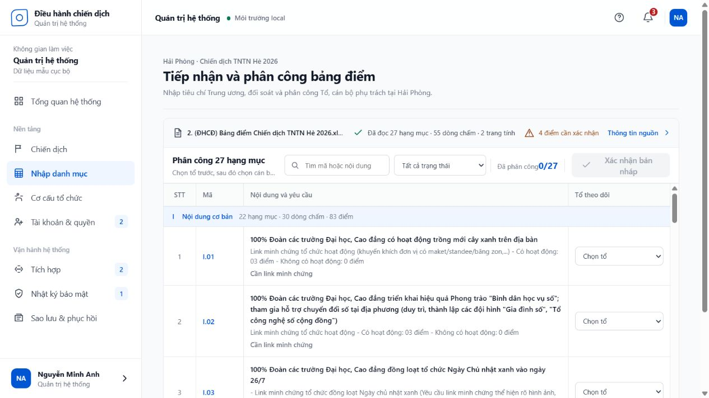
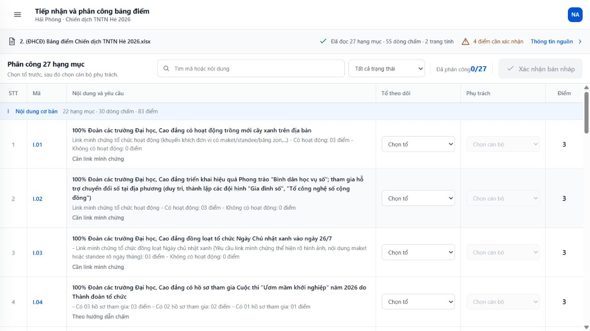
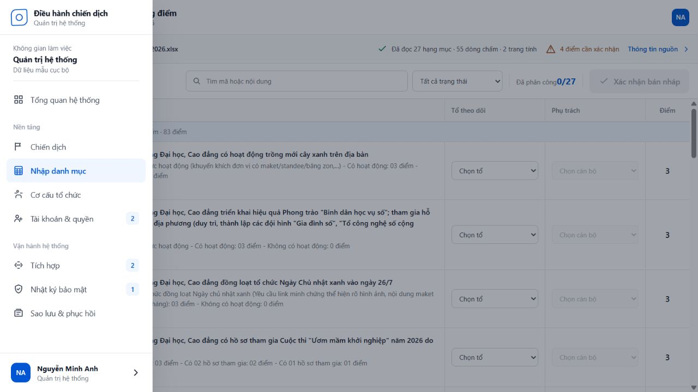

# Audit — chế độ tập trung phân công bảng điểm

Ngày kiểm tra: **12/08/2026**  
Luồng: `Admin → Nhập danh mục → chọn workbook → phân công Tổ/cán bộ`  
Viewport bằng chứng: `1280 × 720`, local-only.

## Kết luận

Màn cũ đã có bảng đúng nghiệp vụ nhưng vẫn mang cấu trúc của một trang dashboard: sidebar thường trực, page header riêng, container có khoảng đệm và bảng lại cuộn bên trong. Với công việc lặp trên 27 hạng mục, bốn lớp chrome này làm giảm vùng dữ liệu và tạo cảm giác “cửa sổ trong cửa sổ”.

Thiết kế mới chuyển route sang workbench tập trung:

- topbar giữ duy nhất tên công việc và ngữ cảnh chiến dịch;
- sidebar trở thành drawer gọi khi cần, không chiếm chiều rộng mặc định;
- bỏ page header và chú thích prototype khỏi vùng làm việc;
- main dùng trọn `1280 × 656 px` còn lại sau topbar;
- trang không cuộn (`document overflow = 0`), bảng là vùng cuộn duy nhất (`538 / 2978 px`);
- điều hướng vẫn khôi phục được bằng nút menu và đóng bằng `Escape`.

## Các bước và bằng chứng

### 1. Trước thay đổi — cần tập trung lại

Sức khỏe: **Kém cho tác vụ dài**.

- Sidebar, tiêu đề trang và khoảng đệm lấy phần đáng kể diện tích.
- Người dùng phải hiểu cả cấu trúc quản trị trước khi đến bảng.
- Vùng cuộn bảng nằm trong một trang vẫn có khả năng cuộn, gây mất phương hướng.

### 2. Workbench toàn nội dung — luồng chính

Sức khỏe: **Tốt**.

- Người dùng nhận biết công việc và chiến dịch ngay trong topbar.
- File nguồn, công cụ phân công, header bảng và dữ liệu nối thành một mặt phẳng liên tục.
- Sáu cột nghiệp vụ đều hiện trong viewport 1280 px.
- Thanh tìm kiếm, lọc, tiến độ và xác nhận không rời khỏi vùng nhìn khi cuộn dữ liệu.

### 3. Mở điều hướng khi cần rời công việc

Sức khỏe: **Tốt**.

- Sidebar không bị xóa; nó đổi thành lớp tạm thời có scrim.
- Nhấn `Escape` đóng drawer và trả focus về nút mở điều hướng.

## Rủi ro khả năng tiếp cận và giới hạn

- `h1` vẫn tồn tại trong main dưới dạng chỉ dành cho công nghệ hỗ trợ; tiêu đề nhìn thấy nằm ở topbar.
- Nút menu có tên truy cập, trạng thái mở/đóng và khôi phục focus.
- Screenshot không chứng minh đầy đủ hành vi trình đọc màn hình hoặc zoom 200%; regression browser tiếp tục kiểm tra landmark, tên control, bàn phím và responsive.
