# Workbook AS-IS — Bảng điểm ĐHCĐ TNTN Hè 2026

Nguồn: [`2. (ĐHCĐ) Bảng điểm Chiến dịch TNTN Hè 2026.xlsx`](<../../2. (ĐHCĐ) Bảng điểm Chiến dịch TNTN Hè 2026.xlsx>)  
Ngày forensic: 12/08/2026  
Phạm vi: đọc cấu trúc, công thức, style và OOXML; không sửa workbook.

Định danh nguồn đã đối soát lại ngày 12/08/2026:

- kích thước: `153.063 byte`;
- SHA-256: `8D29B213907C00D5314C5D9B5FD27E4F09019F013B6A2D5A3DADE44361531653`;
- parser độc lập nhận đúng hai vùng nghĩa `Đại học, Cao đẳng!A1:L40` và `Điểm thưởng!A1:J30`;
- render trực quan của cả hai vùng khớp bố cục, vùng vàng và nội dung mô tả trong tài liệu này.

## 1. Kết luận BA

Workbook hiện là năm thứ cùng lúc:

1. **Bộ tiêu chí** — mô tả điều kiện, bằng chứng và thang điểm.
2. **Biểu mẫu nhập** — màu vàng thay cho quyền chỉnh sửa.
3. **Bộ máy tính** — shared formula tổng hợp và xếp loại.
4. **Phiếu phân công** — tổ theo dõi và người phụ trách nằm ngay trên từng dòng.
5. **Bản bàn giao** — file được gửi qua lại như một snapshot kết quả.

Vì vậy, yêu cầu sản phẩm không phải chỉ là “quản lý chiến dịch”; nó là **chuyển một workbook đang vận hành thành hệ thống có thể nhập/xuất Excel nhưng có quyền, trạng thái và lịch sử rõ ràng**.

## 2. Inventory đã kiểm chứng

| Thuộc tính | Đại học, Cao đẳng | Điểm thưởng |
|---|---:|---:|
| Vùng nội dung có nghĩa | `A1:L40` | `A1:J30` |
| Vùng vật lý OOXML | `A1:Y966` | `A1:Z984` |
| Vùng vàng | `H5:H34`, `K5:K34` | `G4:G30`, `I4:I30`, `J4:J30` |
| Số ô vàng | 60 | 81 |
| Freeze pane | 3 hàng đầu | 2 hàng đầu |
| Data validation | Không có | Không có |
| Sheet protection | Không có | Không có |
| Hyperlink object | Không có | Không có |
| Hidden row/column | Không có | Không có |
| External workbook link | Không có | Không có |

Hai sheet bị định dạng thừa gần 1.000 dòng/cột ngoài nội dung. File nén vẫn nhỏ, nhưng scroll area và parser/importer phải bỏ qua các ô chỉ có style để không tạo hàng chục nghìn bản ghi rỗng.

## 3. Bản đồ cột

### 3.1. Sheet `Đại học, Cao đẳng`

| Cột | Nhãn | Nghĩa miền | Actor hợp lý | Trạng thái hiện tại |
|---|---|---|---|---|
| A | STT | thứ tự/mã dòng | cấu hình | read-only |
| B | Điều kiện chấm điểm | tiêu chí | cấu hình | read-only |
| C | Yêu cầu… nguyên tắc chấm | rule + evidence requirement | cấu hình | read-only |
| D | Tổ theo dõi | nhóm chịu trách nhiệm | chủ chiến dịch | read-only trong hồ sơ |
| E | Phụ trách | người được giao | trưởng tổ/chủ chiến dịch | read-only trong hồ sơ |
| F | Khung điểm | điểm tối đa | scoring engine | công thức/cấu hình |
| G | Tự chấm | điểm đơn vị đề nghị | đơn vị | **không tô vàng** |
| H | Được chấm | điểm người chấm quyết định | chuyên viên | **tô vàng** |
| I | Tỉ lệ % | giá trị dẫn xuất | scoring engine | công thức |
| J | Xếp loại | giá trị dẫn xuất | scoring engine | công thức |
| K | Link minh chứng | một hoặc nhiều evidence reference | đơn vị | tô vàng |
| L | Lý do trừ điểm | reasoning của quyết định | chuyên viên | không tô vàng |

Hướng dẫn ở tiêu đề nói đơn vị chỉ điền vùng vàng. Nhưng vùng vàng hiện trộn trường của đơn vị (`K`) với trường của người chấm (`H`) và bỏ sót `G`. Đây là lỗi giao tiếp vai trò; không được sao chép nguyên trạng sang UI.

### 3.2. Sheet `Điểm thưởng`

| Cột | Nhãn | Actor hợp lý | Trạng thái hiện tại |
|---|---|---|---|
| A–F | mã, điều kiện, rule, tổ, phụ trách, khung điểm | cấu hình/chủ chiến dịch | read-only |
| G | Tự chấm | đơn vị | tô vàng |
| H | Được chấm | chuyên viên/hội đồng | không tô vàng |
| I | Link minh chứng | đơn vị | tô vàng |
| J | Báo cáo tóm tắt | đơn vị | tô vàng |

Sheet thưởng dùng màu vàng nhất quán hơn với actor đơn vị. Điều này củng cố giả thuyết sheet chính đã tô lệch từ `G` sang `H`.

## 4. Cấu trúc hàng và cây tiêu chí

### Nội dung cơ bản

- Hàng `5:34`: 22 tiêu chí đánh số, nhưng một số tiêu chí chiếm nhiều hàng.
- Tiêu chí 21 dùng năm dòng cho kế hoạch, phụ lục tuần và ba đợt báo cáo.
- Tiêu chí 22 dùng năm dòng để các tổ TTNTH, PT, TG, TCKT và VP cùng theo dõi.
- Tổng điểm cơ bản tối đa: `83`.

### Điểm thưởng

- `II.1`: hàng cha 3, mười hàng hoạt động 4–13, 3 điểm/hàng, khung thô 30.
- `II.2`: một hàng 14, tối đa 2.
- `II.3`: một hàng 15, tối đa 10.
- `II.4`: hàng cha 16, sáu tiêu chí con 17–22, tổng 13.
- `II.5`: hàng cha 23, bảy mô hình 24–30, 2 điểm/mô hình, tổng 14.
- Tổng thưởng thô có thể đạt `69`; văn bản quy định toàn phần không vượt `25`.

Mô hình dữ liệu phải hỗ trợ `criterion.parent_id`, thứ tự, loại node tổng hợp và collection lặp. Không ánh xạ mỗi hàng Excel thành một tiêu chí độc lập.

## 5. Formula map đã hiệu chỉnh

Workbook dùng **shared formula**. Formula master chỉ xuất hiện ở ô đầu; các ô con có thẻ formula rỗng nhưng kế thừa công thức tương đối. Đây là lý do lần inspect bề mặt trước đã đọc nhầm một số ô tổng là hardcode.

```text
F3:H3  = cột tương ứng hàng 4 + hàng 35
F4     = SUM(F5:F34)
G4:H4  = SUM(cột tương ứng hàng 5:34)
G35    = SUM(G36:G40)
G36:H40 <- năm nhóm tương ứng từ sheet Điểm thưởng
I3     = H3 / F4
J3     = phân loại theo I3

Điểm thưởng:
F3:H3    = SUM(cột tương ứng hàng 4:13)
F16:H16  = SUM(cột tương ứng hàng 17:22)
F23:H23  = SUM(cột tương ứng hàng 24:30)
```

### Khoảng trống công thức còn thật sự tồn tại

- `H35` không tổng hợp `H36:H40`; vì vậy tổng “Được chấm” ở `H3` hiện không nhận phần thưởng được chấm.
- `G35` không dùng `MIN(25, ...)`; cap 25 chỉ là nhãn/khung điểm, chưa được cưỡng chế.
- `II.1` cho phép cộng 10 dòng lên 30 dù mô tả nói không quá 3 hoạt động.
- `I3 = H3/F4` dùng mẫu số 83 điểm cơ bản. Cần xác nhận phần thưởng có được đưa vào tử số cuối hay chỉ dùng làm thông tin phụ.

## 6. Các loại quy tắc đang ẩn trong văn xuôi

| Rule type | Ví dụ | UI/data nên dùng |
|---|---|---|
| Boolean | có hoạt động: 3; không: 0 | yes/no + evidence |
| Count tier | 1/2/3 hồ sơ → 1/2/3 điểm | numeric count + lookup table |
| Percentage tier | 100%, 80–100%, 60–80%… | numerator/denominator + tier |
| Proportional | điểm theo tỉ lệ chỉ tiêu | allocated/actual count |
| Additive checklist | Mùa hè xanh có nhiều điều kiện cộng | sub-rule checklist |
| Periodic accumulation | 1 điểm/tháng, 0.5 điểm/tuần | occurrence collection |
| Staff observed | không yêu cầu đơn vị đăng minh chứng | verification source + reviewer confirmation |
| Repeating activity | chương trình/mô hình 1…n | dynamic collection, không phải 10 ô cố định |
| Capped aggregate | tổng thưởng không quá 25 | `min(raw, cap)` trong domain |

Nếu tiếp tục để tất cả là một textarea hướng dẫn cộng với ô điểm tự nhập, hệ thống chỉ số hóa workbook chứ chưa loại bỏ sai lệch diễn giải.

## 7. Quy trình AS-IS suy ra từ file

```mermaid
flowchart LR
    A["Ban tổ chức phát hành workbook"] --> B["Mỗi đơn vị có một bản sao"]
    B --> C["Đơn vị đọc rule, tự chấm, dán link và báo cáo"]
    C --> D["Gửi file cho ban tổ chức"]
    D --> E["Các tổ lọc dòng theo Tổ theo dõi/Phụ trách"]
    E --> F["Nhập điểm được chấm và lý do trừ"]
    F --> G["Công thức tổng hợp/xếp loại"]
    G --> H["Gửi lại hoặc phát hành snapshot kết quả"]
```



Workbook chỉ có một cột `Được chấm` và một cột `Lý do trừ điểm`; không chứa cấu trúc riêng cho vòng 1, giải trình và vòng 2. Nếu quy trình có nhiều vòng, các vòng đang được biểu diễn bằng nhiều phiên bản file hoặc ghi đè ô.

## 8. Điểm kiểm soát yếu

- Không protection: actor nào mở file cũng có thể sửa công thức, rule hoặc điểm của actor khác.
- Không data validation: điểm âm, vượt khung hoặc sai bước điểm không bị workbook chặn.
- Link minh chứng chỉ là text cell; không có collection, trạng thái sống/chết hay snapshot.
- Màu là tín hiệu duy nhất về editability và đang mâu thuẫn giữa hai sheet.
- Không audit trail, trạng thái nộp/khóa, receipt hoặc concurrency control.
- Không version identifier cho scorecard; tiêu đề 2025 trong file 2026 cho thấy nguy cơ clone template cũ.
- Vùng vật lý bị phình gần 1.000 dòng, nên importer phải xác định semantic range thay vì tin `dimension`.

## 9. Điều phải giữ khi chuyển sang web

- thứ tự và phân cấp tiêu chí;
- khả năng quét toàn bảng trên desktop;
- frozen context khi cuộn;
- so sánh `khung → tự chấm → được chấm` trên cùng hàng;
- link/báo cáo nằm sát tiêu chí;
- tổng hợp tức thời;
- export lại đúng biểu mẫu để đối soát với quy trình hiện tại.

Điều không được giữ nguyên: dùng màu làm quyền, cho sửa trực tiếp công thức, collection cố định bằng số dòng, và ghi đè quyết định vòng trước.

## 10. Đối soát fixture miền dùng trong Admin

Quality gate của frontend kiểm tra các bất biến lấy từ workbook:

- đúng 22 tiêu chí cơ bản;
- tổng khung điểm cơ bản đúng 83;
- đúng 5 nhóm điểm thưởng;
- tổng khung thưởng thô đúng 69;
- số tiêu chí và tổng điểm của từng tổ khớp phân công;
- mọi tiêu chí đưa lên UX đều có tên, cách ghi nhận, minh chứng và đầu mối.

Fixture không sao chép nguyên văn toàn bộ ô. Tiêu đề được rút gọn để quét nhanh; văn bản nguồn đầy đủ vẫn nằm trong tài liệu forensic và workbook bất biến ở trên.
