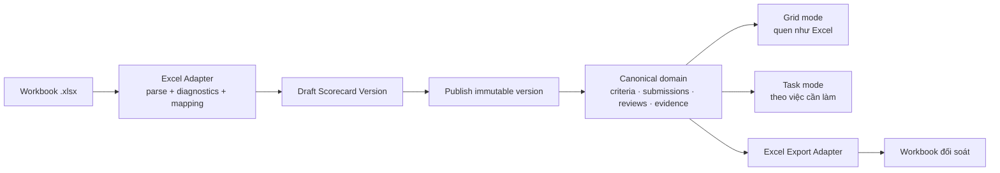

# D-BA-001 — Excel-compatible hybrid, không xây spreadsheet engine tổng quát

Ngày: 12/08/2026  
Trạng thái: đề xuất để duyệt trong BA Lab

## 1. Bối cảnh quyết định

Người dùng đang hoàn thành công việc ngay trong workbook. Mất khả năng xem toàn bảng, copy/paste, đối soát theo hàng hoặc xuất lại file sẽ tạo chi phí chuyển đổi lớn. Ngược lại, sao chép Excel nguyên xi giữ lại các lỗi quyền, phiên bản, validation và audit mà dự án phải giải quyết.

## 2. Các phương án

| Tiêu chí | A. Chuyển file thành spreadsheet web | B. Web form thuần | C. Hybrid được đề xuất |
|---|---|---|---|
| Quen thuộc với người dùng | Rất cao | Trung bình | Cao |
| Giữ đúng biểu mẫu Excel | Cao | Thấp–trung bình | Rất cao qua adapter/export |
| Phân quyền theo vai trò/tiêu chí | Khó | Tốt | Tốt |
| Audit và nhiều vòng chấm | Khó | Tốt | Tốt |
| Mobile/accessibility | Kém | Tốt | Tốt qua Task mode |
| Import template mới | Tốt nếu là engine tổng quát nhưng rất đắt | Khó | Tốt với adapter có kiểm soát |
| Rủi ro công thức tùy ý | Cao | Thấp | Thấp; chỉ nhận dialect đã biết |
| Chi phí xây và bảo trì | Rất cao | Vừa | Vừa, tăng có chủ đích |

### A. Spreadsheet web tổng quát

Không chọn làm lõi. Một engine tương thích Excel phải xử lý merge, formula, style, copy/paste, undo, protection, print, nhiều sheet và hàng loạt edge case. Nó tiêu tốn phần lớn dự án nhưng vẫn không tự tạo workflow, quyền hay audit đúng nghiệp vụ.

### B. Web form thuần

Không chọn đơn độc. Nó giải quyết workflow tốt nhưng làm mất mental model của bảng, khiến việc đối soát 22 tiêu chí và nhiều đơn vị chậm hơn, đồng thời làm import/export trở thành phần phụ dễ sai.

### C. Hybrid workbook-compatible

Chọn. Dữ liệu chuẩn hóa trong domain; Excel là cổng vào/ra và một mode trình bày quen thuộc.

## 3. Kiến trúc sản phẩm được đề xuất

### Canonical domain, không phải cell store

- `ScorecardVersion`
- `Criterion` và `CriterionRule`
- `CriterionAssignment`
- `UnitSubmission`
- `CriterionResponse`
- `EvidenceItem`
- `ReviewDecision`
- `Explanation`
- `ScoreSnapshot`
- `WorkbookImport` và `WorkbookExport`

Không lưu dữ liệu nghiệp vụ bằng tọa độ `G17`, `H17`. Tọa độ chỉ tồn tại trong mapping của adapter theo từng phiên bản template.

## 4. Hai chế độ giao diện cùng một dữ liệu

### 4.1. Grid mode — “quen như Excel”

Dành cho desktop và người dùng cần quét/đối soát nhanh:

- sticky header và frozen columns;
- row group cho `Nội dung cơ bản` và `Điểm thưởng`;
- giữ trật tự cột quen thuộc;
- chỉ ô actor được quyền mới có trạng thái editable rõ ràng;
- keyboard navigation, paste theo cột và undo ở phạm vi draft;
- chọn hàng mở detail inspector bên phải;
- tổng điểm và validation cập nhật tức thời;
- không cho sửa tiêu chí/công thức trong hồ sơ đang làm.

Grid mode là **domain grid**, không phải nhúng Excel hoặc cho chạy formula tùy ý.

### 4.2. Task mode — “làm đúng việc”

Dành cho mobile, người mới và công việc có ngoại lệ:

- danh sách tiêu chí còn thiếu minh chứng;
- hàng đợi theo tổ/người phụ trách;
- màn chi tiết một tiêu chí với rule, response, evidence và history;
- giải trình theo chênh lệch;
- thao tác nguy hiểm có receipt và lý do.

Hai mode phải phản chiếu cùng một state; không có dữ liệu riêng theo mode.

## 5. Excel Adapter có kiểm soát

### Import

1. Nhận file và lưu bản gốc cùng checksum.
2. Nhận diện `template dialect` theo sheet/header, không chỉ tên file.
3. Bỏ qua vùng chỉ có style ngoài semantic range.
4. Parse row hierarchy, max score, team, assignee, rule text và evidence columns.
5. Bung shared formula trước khi đánh giá mapping.
6. Chạy diagnostics: năm, tổng khung, cap, vùng editable, công thức và duplicate code.
7. Hiển thị preview/diff; người có quyền xác nhận mới tạo `Draft ScorecardVersion`.
8. Không tự publish từ file upload.

### Export

- xuất hồ sơ một đơn vị đúng thứ tự/hình thức quen thuộc;
- xuất snapshot vòng 1, vòng 2 hoặc kết quả cuối với nhãn rõ;
- giữ công thức dẫn xuất hoặc ghi giá trị snapshot theo quyết định export;
- nhúng mã chiến dịch, scorecard version, export time và checksum;
- đối soát tổng giữa domain và workbook trước khi trả file.

### Phạm vi không làm

- không nhận mọi workbook Excel bất kỳ;
- không chạy macro/VBA;
- không thực thi formula tùy ý do người dùng tải lên;
- không cam kết pixel-perfect cho template chưa đăng ký;
- không dùng file sau import làm database vận hành.

## 6. Quy tắc thiết kế quan trọng

1. **Familiarity without fragility**: quen cách đọc Excel, bỏ sự mong manh của Excel.
2. Màu hỗ trợ trạng thái, không thay thế quyền hoặc label.
3. `Tự chấm` và `Được chấm` luôn là hai field, hai actor và hai lịch sử.
4. Điểm dẫn xuất chỉ tính ở một engine dùng chung cho UI, API và export.
5. Cấu hình đã publish là bất biến; import lại tạo phiên bản mới.
6. Mọi export chính thức trỏ tới một snapshot bất biến.

## 7. Acceptance gate của quyết định

Giải pháp hybrid được chấp nhận khi prototype chứng minh được:

- import workbook mẫu thành draft và báo đúng các mâu thuẫn đã biết;
- Grid mode cho phép hoàn thành một hồ sơ chỉ bằng bàn phím trên desktop;
- Task mode hoàn thành cùng hồ sơ ở 390 px mà không cần bảng ngang;
- một actor không thể sửa field của actor khác dù can thiệp request;
- core/bonus/cap khớp bộ golden cases đã ký;
- export final mở được trong Excel và đối soát đúng điểm, thứ tự, minh chứng;
- round-trip không làm mất thông tin nghiệp vụ đã được hỗ trợ.
